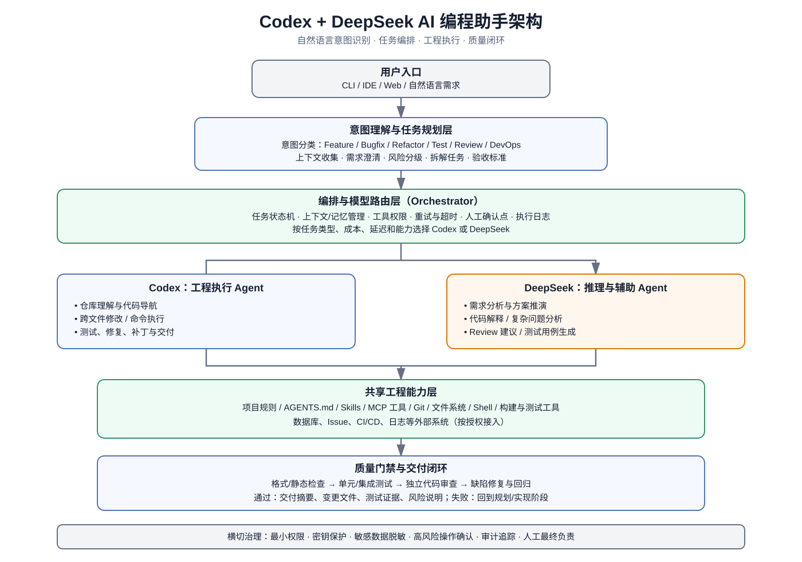
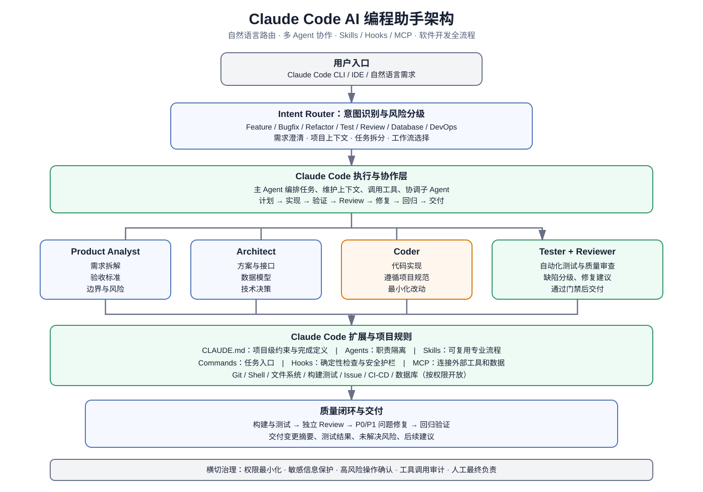

# AI 编程助手架构图

本目录保存 Codex + DeepSeek 与 Claude Code 两套 AI 编程助手架构图，均为 SVG 矢量图，可在浏览器、Markdown、文档和设计工具中查看。

## 架构图

### 1. Codex + DeepSeek

文件：[`codex-deepseek-ai-coding-assistant.svg`](./codex-deepseek-ai-coding-assistant.svg)

主要模块：自然语言入口、意图识别与任务规划、编排与模型路由、Codex 工程执行、DeepSeek 推理辅助、共享工程能力、质量门禁与安全治理。

### 2. Claude Code

文件：[`claude-code-ai-coding-assistant.svg`](./claude-code-ai-coding-assistant.svg)

主要模块：Intent Router、多 Agent 协作、CLAUDE.md、Agents、Skills、Commands、Hooks、MCP、测试审查与交付闭环。

## 通用开发闭环

用户自然语言需求 → 意图识别 → 需求澄清 → 任务规划 → 架构设计 → 代码实现 → 构建与测试 → 代码审查 → 缺陷修复与回归 → 交付。

## 设计说明

- Codex 与 DeepSeek 的职责划分是可配置的参考方案，并非要求所有任务都必须双模型执行。
- Claude Code 图展示的是推荐的工程组织方式；Agent、Skill、Hook 与 MCP 的实际配置应以仓库和运行环境为准。
- 对部署、删除数据、生产变更、密钥访问等高风险操作，应配置权限边界并要求人工确认。
